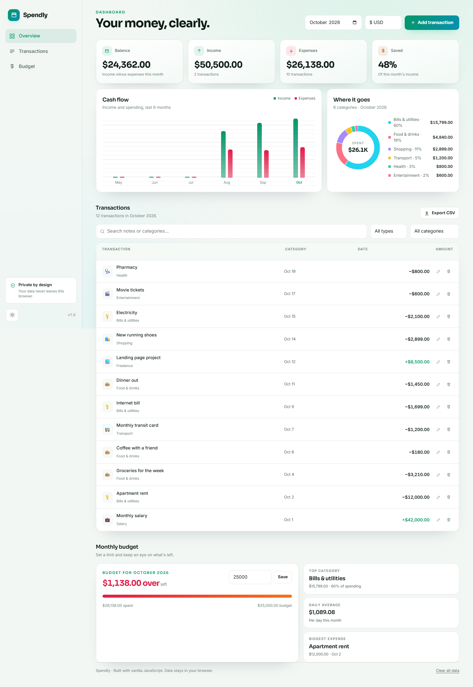

# Spendly — Personal Finance Tracker

Spendly is a fast, private expense tracker that runs entirely in your browser. Track income and spending, set a monthly budget, see where your money goes, and export your data — no account, no server, no tracking.

**Live app:** https://sphinxss.github.io/spendly/



## Features

- **Overview dashboard** — balance, income, expenses, and savings rate for any month.
- **Cash-flow chart** — compare income and spending across the last six months.
- **Category breakdown** — an SVG donut chart with a ranked spending list.
- **Transactions** — add, edit, and delete entries; search and filter by type or category.
- **Monthly budget** — set a limit per month and track what is left with a progress bar.
- **Insights** — top category, daily average spend, and biggest expense.
- **CSV export** — download the current filtered view for spreadsheets.
- **Multi-currency** — PHP, USD, EUR, JPY, and GBP.
- **Dark and light themes** — remembered between visits.
- **Installable PWA** — works offline after the first load.
- **Local-first** — all data is stored in `localStorage` on your device.

## Tech stack

Vanilla HTML, CSS, and JavaScript. No frameworks, no build step, no dependencies. Charts are hand-built with SVG and CSS. The app shell is cached by a service worker.

## Run locally

Any static server works:

```bash
python -m http.server 8080
```

Then open <http://localhost:8080>.

## Data & privacy

Spendly never sends your data anywhere. Transactions, budgets, and preferences live in your browser's `localStorage` under `spendly-v1`. Clearing the app data or using **Clear all data** removes them permanently.

Sample transactions are loaded on first visit so the dashboard is not empty. They can be removed with **Clear all data**.

## Project structure

```
spendly/
├── index.html          # App shell and markup
├── styles.css          # Theme, layout, charts, responsive styles
├── app.js              # State, storage, charts, CRUD, export
├── manifest.webmanifest
├── sw.js               # Offline app-shell cache
└── icons/
```

## Keyboard & accessibility notes

- All controls are keyboard reachable.
- The transaction dialog uses native `<dialog>` focus management.
- Charts include accessible labels and hover/focus tooltips.
- Reduced-motion preferences are respected.

## Author

Built by **Joshua Barrera** — [github.com/sphinxss](https://github.com/sphinxss)
